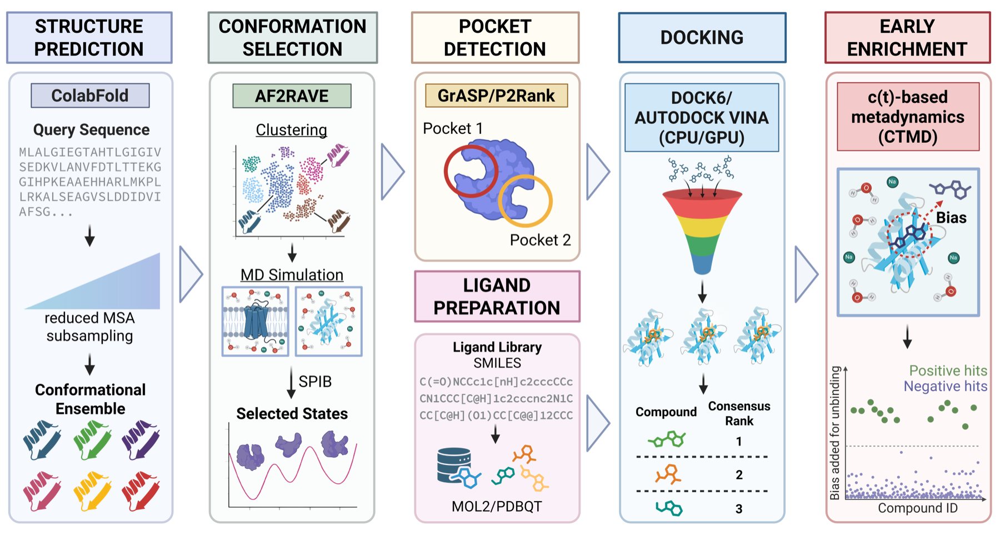

# ANTIOCH-VS

**ANTIOCH-VS** (Automated, Networked Toolkit for In-silico Open-source
Conformational-ensemble Hit-discovery — Virtual Screening) is a modular,
open-source framework for end-to-end ensemble virtual screening. Starting from a
protein sequence — or a structure you supply — it generates a conformational
ensemble, detects binding pockets, prepares receptors and ligand libraries, docks
against the ensemble with DOCK6 and AutoDock Vina, ranks hits by consensus across
the ensemble, and triages the top candidates with a physics-based post-docking
step.



*The ANTIOCH-VS pipeline. Starting from a target sequence, the framework proceeds
through structure prediction (ColabFold reduced-MSA ensemble), conformation
selection (AF2RAVE clustering, unbiased MD, and SPIB), pocket detection and ligand
preparation, docking against each ensemble receptor with consensus ranking, and
early-enrichment triage by c(t)-metadynamics.*

Each stage is a self-contained, configuration-driven module with its own guide, so
the workflow is reproducible and easy to extend: new structure predictors, docking
engines, or post-docking methods can be added without restructuring the pipeline.
Modules run natively, under `micromamba`, or inside Singularity/Apptainer
containers, on a workstation or an HPC cluster.

## What it does

From sequence (or a supplied receptor) to a ranked shortlist of candidate binders:

- **Structure & ensemble generation** *(optional)* — ColabFold with reduced-MSA
  subsampling, then AF2RAVE feature selection, clustering, unbiased MD, and State
  Predictive Information Bottleneck (SPIB) analysis to select a few
  Boltzmann-ranked metastable conformations for docking (soluble and membrane
  proteins). Already have a receptor structure or a conformational ensemble? Skip
  this stage and go straight to docking.
- **Pocket detection** — binding-site detection with P2Rank and GrASP, exported as
  engine-independent docking boxes when no site is known in advance.
- **Receptor & ligand preparation** — receptor cleaning and optional loop
  truncation/capping; ligand-library conversion from SMILES into docking-ready
  inputs.
- **Docking** — flexible docking with DOCK6 and batch docking with AutoDock Vina
  (CPU and GPU), with optional DOCK6 critical-sphere restraints.
- **Consensus ranking** — unweighted reciprocal-rank fusion across the receptor
  ensemble, plus enrichment metrics for retrospective benchmarks.
- **Post-docking triage** — stage top consensus receptor–ligand pairs into
  c(t)-metadynamics (CTMD) projects, and prepare AMBER topologies and solvated
  systems for downstream MD.

## Repository layout

- `full_pipeline/` — end-to-end orchestration and an optional GUI launcher
  (invokable as `antioch-vs`)
- `structure_prediction_module/` — ensemble generation, feature selection,
  clustering, and MD/SPIB workflows
- `pocket_detection_module/` — binding-site detection (P2Rank, GrASP)
- `protein_prep_module/` — receptor cleaning, truncation, and capping
- `ligprep_module/` — ligand-library preparation
- `docking_module/` — DOCK6 and Vina pipelines, consensus ranking, and
  post-docking analysis
- `ctmd_module/` — AMBER MD / CTMD setup for soluble and membrane systems
- `common_module/` — shared HPC/SLURM submission helpers
- `test_files/` — example configurations and small test fixtures

## Start here

ANTIOCH-VS is an orchestration layer around external scientific software, not a
self-contained package. The quickest way in is to skim the guide for the stage you
need — each is config-driven and can be run on its own, or chained through
`full_pipeline/` for a complete sequence-to-hits run:

- [structure_prediction_module/README.md](structure_prediction_module/README.md)
- [pocket_detection_module/README.md](pocket_detection_module/README.md)
- [ligprep_module/README.md](ligprep_module/README.md)
- [docking_module/README.md](docking_module/README.md)
- [ctmd_module/README.md](ctmd_module/README.md)

The module guides cover the required external tools, expected input formats,
example configuration files, copy-pasteable commands, notes for native /
micromamba / Singularity execution, and common failure points.

## Requirements

Depending on which modules you use, you will need some or all of the following:

- DOCK6, and UCSF Chimera for DOCK6 receptor preparation
- AutoDock Vina or Vina-GPU
- P2Rank (a JVM program; needs a JDK/JRE) and/or GrASP (a separate clone with its
  own environment) for pocket detection
- AmberTools for MD/CTMD setup
- `micromamba` or a compatible environment manager
- Singularity/Apptainer when using the provided `.sif` containers
- The Python environments declared per module (e.g.
  `docking_module/vina_pipeline/vina_env.yml`,
  `pocket_detection_module/pocket_detection_env.yml`)

## Status

- Structure-ensemble generation (ColabFold reduced-MSA, feature selection,
  clustering, unbiased MD, SPIB) is implemented for soluble and membrane proteins
- Pocket detection is implemented for both P2Rank and GrASP, each exporting ranked
  pockets and rank-1 docking boxes
- Docking is implemented for DOCK6 (flexible, with optional critical spheres) and
  AutoDock Vina (CPU and GPU), with consensus ranking and enrichment evaluation
- CTMD and AMBER MD input preparation are implemented; MD production protocols
  remain user supplied

## Contributing

Contributions are welcome, especially around documentation, workflow hardening, and
future expansion of the pipeline.

## Citation

If you use ANTIOCH-VS in your work, please cite:

> Hasdemir, H. S., Adury, V. S. S., & Tiwary, P. (2026). *ANTIOCH-VS: From Sequence
> to Hits with Modular, Open-Source Ensemble Virtual Screening.* arXiv:2611.14287.
> https://arxiv.org/abs/2611.14287

BibTeX:

```bibtex
@misc{hasdemir2026antiochvs,
  title         = {ANTIOCH-VS: From Sequence to Hits with Modular, Open-Source Ensemble Virtual Screening},
  author        = {Hasdemir, Hale S. and Adury, Venkata Sai Sreyas and Tiwary, Pratyush},
  year          = {2026},
  eprint        = {2611.14287},
  archivePrefix = {arXiv},
  primaryClass  = {physics.chem-ph},
  doi           = {10.48550/arXiv.2611.14287},
  url           = {https://arxiv.org/abs/2611.14287}
}
```

## License

Released under the MIT License — see [LICENSE](LICENSE).
